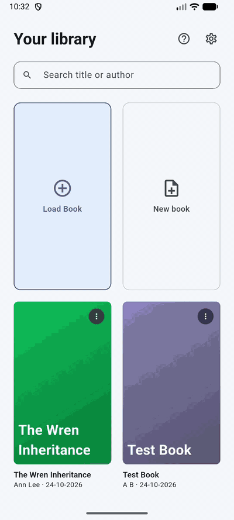
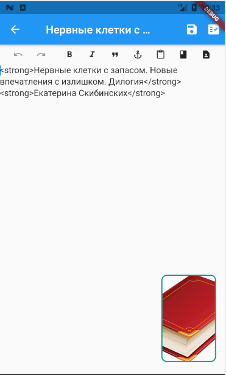
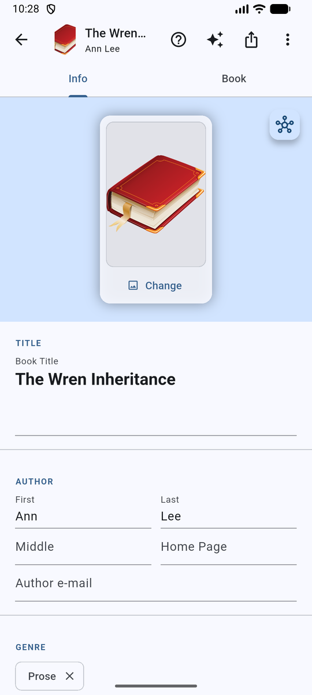
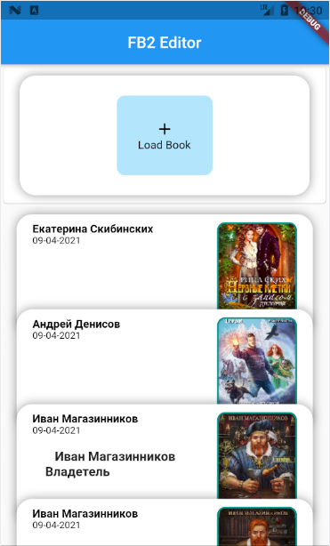
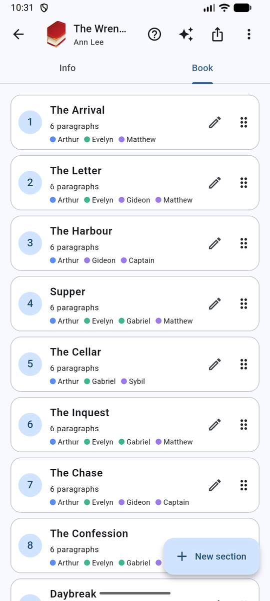
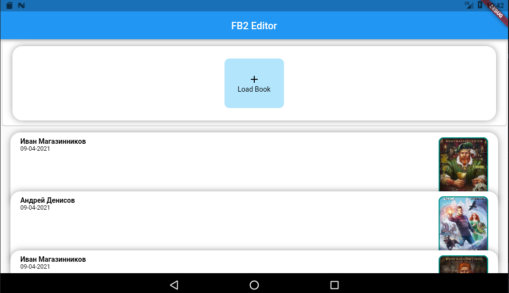

<div align="center">
  
  <h1>FB2 Editor</h1>
  <p>
    <a href="LICENSE"></a>
    
    <a href="https://play.google.com/store/apps/details?id=com.caragulak.fb2editor"></a>
    <a href="https://fb2-editor.surge.sh"></a>
    <a href="https://arach-telar.surge.sh/"></a>
    
    
  </p>
  <p><em>Your fiction books, your files, your editor — on your Android device, or right in your browser.</em></p>
</div>

---

> ✨ **There's a new version!** The next iteration of FB2 Editor is live at
> **[arach-telar.surge.sh](https://arach-telar.surge.sh/)** — packed with UI/UX improvements and
> many bug fixes. Go play with it!

## Demo

<table>
  <tr>
    <td align="center"></td>
    <td align="center"></td>
    <td align="center"></td>
  </tr>
  <tr>
    <td align="center"></td>
    <td align="center"></td>
    <td align="center"></td>
  </tr>
</table>

**No phone handy?** [Try the web build live](https://fb2-editor.surge.sh) — FB2 Editor in your browser, no install required.

## Features

- **FB2 Native:** opens FictionBook 2 (`.fb2`) files — and `.zip` archives that contain them — straight from your device's storage.
- **Damaged-book friendly:** a lenient XML parser strips offending nodes and re-retries, so imperfectly formed books still open.
- **Windows-1251 support:** decodes legacy Cyrillic (CP1251) encodings common in older FB2 files.
- **Rich-text editing:** each section opens in a Quill-based editor with headers, bold, italic, links, text/background color, lists, checklists, indentation, clear formatting, and undo/redo.
- **Real FB2 output:** formatting round-trips into FictionBook tags on save — bold → `<strong>`, italic → `<emphasis>`, blockquote → `<cite>`.
- **Section manager:** create, rename, batch-delete, and drag-reorder sections; images embedded in FB2 as base64 `<binary>` resources.
- **Full book metadata:** edit title, author (first/middle/last name, home page, nickname), genre, sequence, annotation, and cover page.
- **Story map:** an automatic map of who and what appears in which section, built from your text on your device. Add and edit people, places, events and lore, connect them, filter and zoom, and keep it inside the book file.
- **Local-first:** the workspace and your books live in the app's private documents directory — no account, no server, nothing to configure in the cloud.
- **Bilingual UI:** English and Russian, switchable in settings.

## Installation

### From Google Play

Install [FB2 Editor from the Play Store](https://play.google.com/store/apps/details?id=com.caragulak.fb2editor).

### In your browser

This repo's web build is deployed at **[fb2-editor.surge.sh](https://fb2-editor.surge.sh)** — just open it and load a book. (For the newer iteration, see the announcement above.) To serve it locally:

```sh
flutter build web
```

Deploy your own copy with `tool/deploy_surge.sh <domain>` (needs the `surge` CLI).

### Build from source

You'll need Flutter with Dart SDK ≥ 3.0.0:

```sh
git clone git@github.com:Basiliskin/FB2-Editor.git
cd FB2-Editor
flutter pub get
flutter run          # deploy to a connected Android device
flutter build apk --release
```

Release builds read signing config from `android/key.properties` plus a keystore — neither is (or should be) committed.

## Getting Started

1. On the home screen, tap **Load Book** and pick a `.fb2` or `.zip` file from your device.
2. The book opens with two tabs: **Info** (metadata form) and **Book** (section list).
3. Tap a section to edit it; use the toolbar for formatting, and the drag handle in the section list to reorder.
4. Save with the disk icon; export a copy of the finished `.fb2` anywhere you like via the export action.

Recently opened books are kept in the home-screen history (up to 10).

## Configuration

Everything is on the **Settings** screen — no config files required:

| Setting | What it does |
|---|---|
| Auto save book | Saves the book when you leave the editor |
| Show page image | Adds the per-section image picker button to the editor |
| Image size | Width used when embedding section images |
| Image Quality | Compression quality for embedded images |
| Font Size | Editor text size |
| Language | English or Russian |

## Whatcha think?

This project doubles as a portfolio piece, so feedback is genuinely welcome — bugs, rough edges,
feature ideas. [Open an issue](https://github.com/Basiliskin/FB2-Editor/issues) and let me know what
you think.

## License

FB2 Editor is licensed under the [MIT License](LICENSE).
