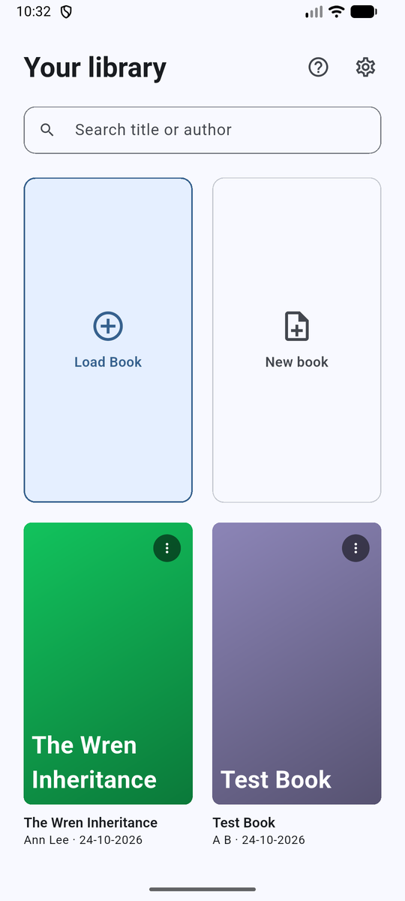
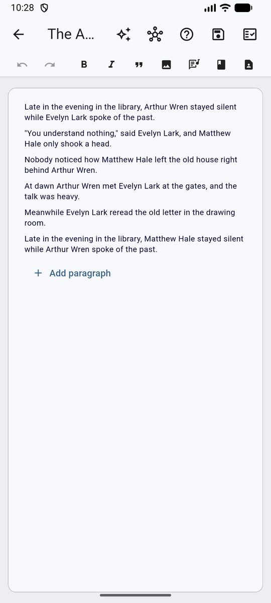
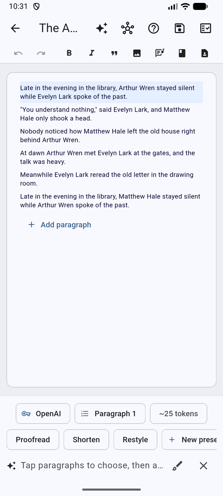
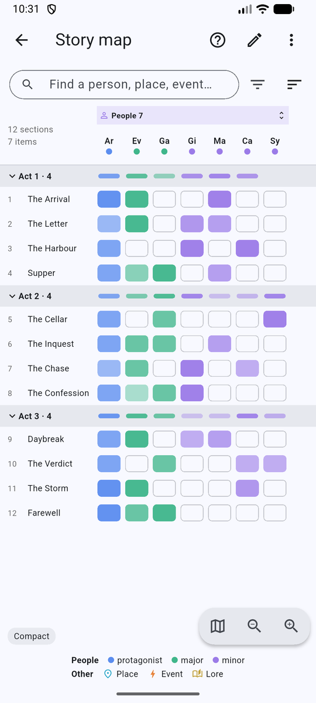
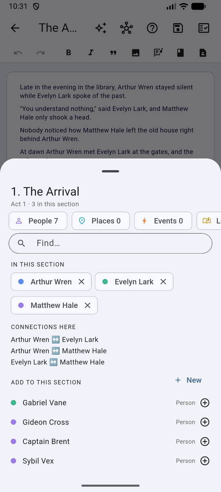
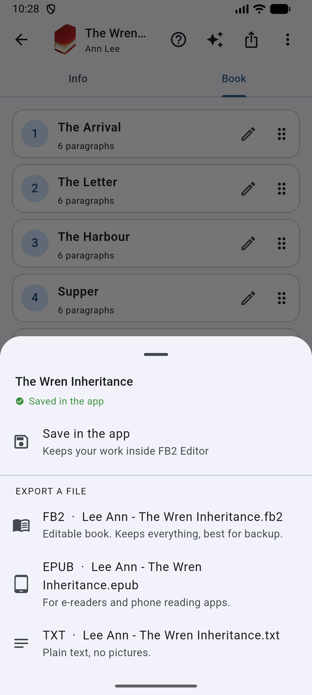
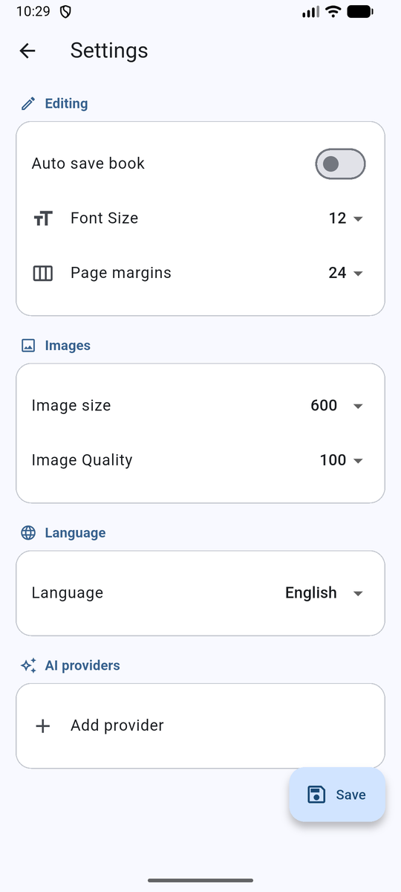

<div align="center">
  
  <h1>FB2 Editor</h1>
  <p>
    <a href="LICENSE"></a>
    
    <a href="https://play.google.com/store/apps/details?id=com.caragulak.fb2editor"></a>
    <a href="https://fb2-editor.surge.sh"></a>
    <a href="https://arach-telar.surge.sh/"></a>
    
    
  </p>
  <p><em>Your fiction books, your files, your editor — on your Android device, or right in your browser.</em></p>
</div>

---

> ✨ **There's a new version!** The next iteration of FB2 Editor is live at
> **[arach-telar.surge.sh](https://arach-telar.surge.sh/)** — packed with UI/UX improvements and
> many bug fixes. Go play with it!

## Demo

<table>
  <tr>
    <td align="center" rowspan="2"></td>
    <td align="center"></td>
    <td align="center"></td>
    <td align="center"></td>
  </tr>
  <tr>
    <td align="center"></td>
    <td align="center"></td>
    <td align="center"></td>
  </tr>
  <tr>
    <td></td>
    <td align="center"></td>
    <td align="center"></td>
    <td align="center"></td>
  </tr>
</table>

**No phone handy?** [Try the web build live](https://fb2-editor.surge.sh) — FB2 Editor in your browser, no install required.

## Features

### Open, edit, export

- **FB2 native:** opens FictionBook 2 (`.fb2`) files, `.zip` archives that contain them, `.epub` books and plain `.txt`. No storage permission needed.
- **EPUB in, EPUB out:** chapters, cover, pictures, bold and italics come in as an editable book; export produces an EPUB any e-reader app opens, with cover, pictures, footnotes and a table of contents.
- **Start from scratch:** create a new book, or add another book's sections to the one you have open.
- **Damaged-book friendly:** a lenient XML parser strips offending nodes and retries, so imperfectly formed books still open. Large books open, footnotes and text styles survive, and a `.bak` safety copy is kept on save.
- **Windows-1251 support:** decodes legacy Cyrillic (CP1251) encodings common in older FB2 files.
- **Rich-text editing:** each section opens in a Quill-based editor with headers, bold, italic, links, text/background color, lists, checklists, indentation, poems, clear formatting, undo/redo, and find & replace.
- **Real FB2 output:** formatting round-trips into FictionBook tags on save: bold → `<strong>`, italic → `<emphasis>`, blockquote → `<cite>`.
- **Section manager:** create, rename, batch-delete, swipe-delete and drag-reorder sections; pictures inside chapters stay in place and can be added or removed (stored as base64 `<binary>` resources).
- **Full book metadata:** title, author (first/middle/last name, home page, nickname, e-mail), genre, sequence, annotation, id, version, language, date, keywords and cover page.
- **One Save & export sheet:** save in the app, or export FB2, EPUB or TXT anywhere you like, from one place.

### Story map

An automatic map of who and what appears in which section, built from your text on your device. Add and edit people, places, events and lore, connect them, mark where they appear, filter, search and zoom. A single section's map is available inside the section editor. The map is saved inside the FB2 file; other readers ignore it.

### Improve with AI (optional)

- **Bring your own provider:** add Gemini, OpenAI or Anthropic in Settings with your own API key and model name. Several providers can be saved; one is the default. An optional custom base URL supports compatible endpoints, and **Test connection** checks the key before you use it.
- **Review before anything changes:** select paragraphs, pick Proofread, Shorten, Restyle or write your own instruction, and compare the suggestion before and after. Nothing changes until you accept; Undo is one tap.
- **Custom presets and a style note:** save your own instructions as presets and keep a per-book style note that goes with every request.
- **Whole sections in parts:** long sections are split into chunks and sent one by one; each suggestion waits in a review queue to accept or reject. The **Chunk limit** per provider controls how much text goes in one request.
- **Honest about failures:** if the model's answer is cut off, the app says so, retries in smaller parts and tells you what to change. It also says plainly when a browser is blocking the provider on the web build.
- **Private by default:** nothing is sent unless you ask, your key stays on your device, and the connection is https only. See the [privacy policy](docs/privacy-policy.html).

### Everywhere

- **Local-first:** the workspace and your books live in the app's private documents directory. No account, no server, nothing to configure in the cloud.
- **Bilingual UI:** English and Russian, switchable in settings, plus an in-app Help page.

## Installation

### From Google Play

Install [FB2 Editor from the Play Store](https://play.google.com/store/apps/details?id=com.caragulak.fb2editor).

### In your browser

This repo's web build is deployed at **[fb2-editor.surge.sh](https://fb2-editor.surge.sh)** — just open it and load a book. (For the newer iteration, see the announcement above.) To serve it locally:

```sh
flutter build web
```

Deploy your own copy with `tool/deploy_surge.sh <domain>` (needs the `surge` CLI).

### Build from source

You'll need Flutter with Dart SDK ≥ 3.0.0:

```sh
git clone git@github.com:Basiliskin/FB2-Editor.git
cd FB2-Editor
flutter pub get
flutter run          # deploy to a connected Android device
flutter build apk --release
```

Release builds read signing config from `android/key.properties` plus a keystore — neither is (or should be) committed.

## Getting Started

1. On the home screen, tap **Load Book** and pick a `.fb2`, `.zip`, `.epub` or `.txt` file from your device, or create a new book.
2. The book opens with two tabs: **Info** (metadata form) and **Book** (section list).
3. Tap a section to edit it; use the toolbar for formatting, and the drag handle in the section list to reorder.
4. Tap **Save & export** to save in the app or export a copy as FB2, EPUB or TXT anywhere you like.
5. Open the **Story map** from the Info tab, and **Improve with AI** from the section editor once a provider is set up in Settings.

Recently opened books are kept in the home-screen history (up to 10).

## Configuration

Everything is on the **Settings** screen, no config files required:

| Setting | What it does |
|---|---|
| Auto save book | Saves the book when you leave the editor |
| Font Size | Editor text size |
| Page margins | Horizontal padding of the editor text |
| Image size | Width used when embedding section images |
| Image Quality | Compression quality for embedded images |
| Language | English or Russian |
| AI providers | Add, edit, test and pick a default Gemini, OpenAI or Anthropic provider: API key, model, optional base URL, chunk limit |

## Documentation

- [GLOSSARY.md](GLOSSARY.md): the project's domain terms (Section, Story map, Provider, Chunk, Suggestion and so on).
- [docs/adr](docs/adr): architecture decision records, including why AI providers are called directly without a proxy and why the story map lives inside the FB2 file.
- [docs/RELEASE.md](docs/RELEASE.md): release process; per-version notes are alongside it.
- [Privacy policy](docs/privacy-policy.html).

## Whatcha think?

This project doubles as a portfolio piece, so feedback is genuinely welcome — bugs, rough edges,
feature ideas. [Open an issue](https://github.com/Basiliskin/FB2-Editor/issues) and let me know what
you think.

## License

FB2 Editor is **source-available**, not open source. You are welcome to read the code, build it for
yourself and send pull requests. Publishing the app, or anything derived from it, on Google Play or
anywhere else requires my written permission, and anything published with that permission must
stay open: full source under the same licence, with credit and marked changes. See
[LICENSE](LICENSE) for the exact terms.

Versions published before this change remain under the MIT License they were released with.
